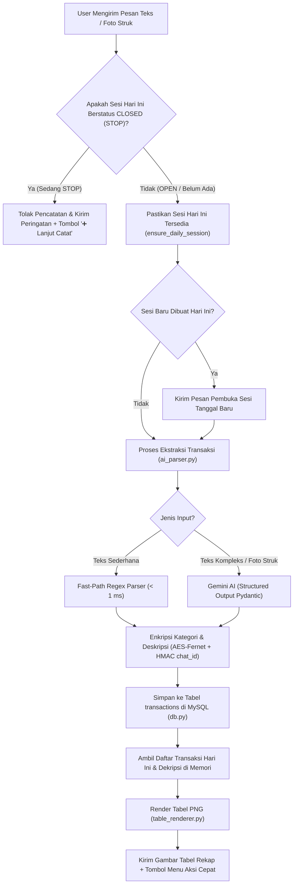

# 💰 HematUang Bot — Asisten Pencatat Keuangan Telegram Berbasis AI

**HematUang Bot** adalah bot Telegram pencatat keuangan harian dan bulanan berbasis **Python (`aiogram` v3)** yang memadukan **Hybrid AI Parser (Instant Local NLP + Google Gemini Vision/Text)**, **Enkripsi Database AES-Fernet Per-User**, serta **Visualisasi Tabel Otomatis (`matplotlib`)**.

Pengguna cukup mengirimkan pesan chat biasa (misal: *"Beli kopi susu 22rb"*, *"Gaji masuk 6,5jt"*) atau mengirimkan **foto struk belanja / bukti transfer**, dan bot akan otomatis mengekstrak nominal, tipe transaksi, kategori, menyimpannya secara terenkripsi ke MySQL/MariaDB, lalu membalas dengan gambar tabel rekap terbaru.

---

## ✨ Fitur Utama

1. **Hybrid AI & Instant Parser (`< 1 ms` & Multimodal Vision)**
   - **Fast-Path Local Parser:** Mengenali pesan teks transaksi harian berbahasa Indonesia (termasuk singkatan `rb`, `ribu`, `k`, `jt`, `juta`) secara instan dalam `< 1 ms` tanpa jeda jaringan.
   - **Gemini AI Multimodal Fallback:** Menggunakan `google-genai` dengan Pydantic *Structured Outputs* untuk mengekstrak kalimat kompleks serta membaca **foto struk belanja / screenshot bukti transfer**.
2. **Enkripsi Data Sensitif Per-User (At-Rest Encryption)**
   - Kolom sensitif (`category` dan `description`) dienkripsi menggunakan **AES-128-CBC + HMAC-SHA256 (`cryptography.fernet`)**.
   - Kunci enkripsi setiap pengguna diturunkan secara unik dari kombinasi `ENCRYPTION_KEY` + `chat_id` menggunakan `HMAC-SHA256`, sehingga data antar-pengguna terisolasi secara kriptografis di database.
3. **Visualisasi Tabel Otomatis (`matplotlib`)**
   - Merender rekap transaksi harian dan bulanan menjadi gambar tabel PNG yang rapi dan tajam langsung di dalam chat Telegram.
   - Dilengkapi ringkasan **Total Masuk**, **Total Keluar**, dan **Selisih Hari Ini / Bulan Ini**.
4. **Menu Tombol Interaktif & Popup Command `/`**
   - Setiap balasan bot dilengkapi tombol aksi cepat (**➕ Lanjut Catat**, **📊 Rekap Hari Ini**, **🗑️ Hapus Transaksi**, **📆 Rekap Bulanan**, **🛑 Stop / Tutup Buku**, **📖 Panduan**).
   - Mendukung penghapusan transaksi spesifik melalui tombol pilihan interaktif (`/hapus`).
   - Proteksi status **STOP**: Saat sesi dihentikan (`/stop`), bot menolak pencatatan baru dan mengingatkan pengguna untuk menekan **➕ Lanjut Catat** atau `/start` terlebih dahulu tanpa menghapus data sebelumnya.
5. **Tutup Buku Otomatis Pukul `00:00` WIB (`AsyncIOScheduler`)**
   - Setiap pergantian hari pukul `00:00` WIB (`Asia/Jakarta`), bot otomatis menutup sesi hari sebelumnya (`CLOSED`) dan mengirimkan laporan rekap final beserta kategori pengeluaran terbesar dan akumulasi saldo bulanan secara *silent* (`disable_notification=True`) agar tidak mengganggu waktu istirahat.

---

## 📂 Struktur File Proyek

```text
hematuangBot/
├── bot.py               # Entry point utama bot, router handler aiogram v3, menu interaktif, & scheduler 00:00 WIB
├── ai_parser.py         # Modul ekstraksi transaksi (Hybrid Fast-Regex + Google Gemini Structured Outputs)
├── db.py                # Modul async database (aiomysql connection pool + enkripsi/dekripsi AES-Fernet per-user)
├── table_renderer.py    # Renderer tabel transaksi harian & bulanan menjadi gambar PNG (matplotlib)
├── schema.sql           # Skema pembuatan database MySQL/MariaDB (tabel daily_sessions & transactions)
├── requirements.txt     # Daftar dependensi Python
├── .env.example         # Template konfigurasi environment variables
├── .env                 # File konfigurasi rahasia (diabaikan oleh Git)
└── .gitignore           # Daftar file/folder yang diabaikan oleh Git (venv, .env, .mplcache, __pycache__)
```

---

## 🔄 Alur Kerja Sistem (Workflow)

### 1. Diagram Alur Pencatatan Transaksi



### 2. Alur Penutupan Sesi Otomatis (`00:00` WIB) & Manual (`/stop` / `/tutup`)
1. **Manual (`/stop` atau `/tutup`):**
   - Mengubah status sesi hari ini menjadi `CLOSED` di tabel `daily_sessions`.
   - Menghitung total pemasukan, total pengeluaran, kategori pengeluaran terbesar hari itu, serta akumulasi saldo bulan berjalan.
   - Mengirimkan tabel rekap final dan mengunci sesi hingga pengguna menekan **➕ Lanjut Catat** atau `/start`.
2. **Otomatis (`00:00` WIB via `AsyncIOScheduler`):**
   - Mengecek seluruh sesi tanggal kemarin yang masih berstatus `OPEN`.
   - Jika sesi sudah ditutup manual sebelumnya dengan `/stop` atau `/tutup`, bot tidak akan mengirim ulang laporan.
   - Jika masih `OPEN`, bot mengubah statusnya menjadi `CLOSED` dan mengirimkan tabel rekap final hari kemarin secara *silent*.

---

## 🧩 Penjelasan Detail Setiap Modul

### 1. `db.py` & `schema.sql` (Database & Keamanan Enkripsi)
- **`daily_sessions`**: Menyimpan status sesi harian per pengguna (`session_date`, `chat_id`, `status ENUM('OPEN','CLOSED')`, `created_at`, `closed_at`).
- **`transactions`**: Menyimpan riwayat transaksi (`id`, `session_date`, `chat_id`, `type ENUM('INCOME','EXPENSE')`, `amount`, `category`, `description`, `created_at`).
- **Enkripsi Per-User (`_get_user_fernet`)**:
  - Menggunakan `HMAC-SHA256(ENCRYPTION_KEY, "hematuang_user:<chat_id>")` untuk menghasilkan kunci Fernet 32-byte yang unik bagi setiap `chat_id` dan menyimpannya di cache memori (`_fernet_cache`).
  - Fungsi `insert_transaction()` mengenkripsi `category` dan `description` sebelum masuk ke database, sedangkan `get_transactions_by_date()`, `delete_transaction_by_id()`, dan `get_monthly_summary()` mendekripsinya secara transparan saat dibaca.

### 2. `ai_parser.py` (Ekstraksi Transaksi Berbasis AI & Fast-Path)
- Menggunakan schema Pydantic `TransactionExtraction` (`type`, `amount`, `category`, `description`).
- Memiliki fungsi `_try_fast_parse()` untuk menangani input chat sehari-hari secara instan tanpa latensi API eksternal.
- Untuk foto struk/bukti transfer (`parse_transaction_image`) dan kalimat kompleks, menggunakan `google-genai` dengan `thinking_budget=0`, `automatic_function_calling=disable`, *hard timeout* 8 detik, serta *auto-fallback* lintas model (`gemini-3.5-flash-lite` → `gemini-3.5-flash` → `gemini-3.7-flash` → `gemini-3.6-flash` → `gemini-3.8-flash`).

### 3. `table_renderer.py` (Visualisasi Tabel PNG)
- Menggunakan `matplotlib` (backend non-GUI `Agg`) dengan direktori cache font lokal (`.mplcache`) agar proses import dan rendering berlangsung cepat.
- Menyediakan dua fungsi utama:
  - `render_daily_table(date_str, transactions)`: Merender tabel transaksi harian beserta baris **TOTAL MASUK**, **TOTAL KELUAR**, dan **SELISIH HARI INI**.
  - `render_monthly_table(year_month, summary)`: Merender tabel rekapitulasi bulanan per tanggal beserta **SALDO / SELISIH BULAN INI**.

### 4. `bot.py` (Controller Utama, Menu Interaktif, & Scheduler)
- Mengatur seluruh command (`/start`, `/lanjut`, `/rekap`, `/bulanan`, `/hapus`, `/restart`, `/stop`, `/tutup`, `/help`) dan callback tombol inline (`menu:*`, `del_tx:*`, `restart_*`).
- Mengimplementasikan `StableAiohttpSession` untuk menjaga kestabilan koneksi ke server Telegram di lingkungan Windows & ISP Indonesia.

---

## 🛠️ Masalah yang Ditemukan & Solusi Rekayasa (Troubleshooting Log)

Selama pengembangan dan pengujian langsung, beberapa kendala nyata berhasil diidentifikasi dan diselesaikan:

| No | Masalah yang Ditemukan | Penyebab Teknis (Root Cause) | Solusi yang Diterapkan |
| :--- | :--- | :--- | :--- |
| **1** | **Error `404 NOT_FOUND` & `503 UNAVAILABLE` pada Model Gemini** | Endpoint `gemini-2.5-flash` sudah dihentikan untuk akun baru Google AI Studio, sementara model terbaru kadang mengalami lonjakan trafik (`503`). | Membuat mekanisme **Multi-Model Auto-Fallback** di `ai_parser.py` dengan `attempts=1` per model serta menyimpan model aktif tercepat (`_preferred_model`) di memori. |
| **2** | **Respon Teks Sangat Lambat (Hingga 5–6 Menit / `372.444 ms`)** | Secara bawaan, SDK `google-genai` mengaktifkan *Automatic Function Calling (AFC)* dan *Thinking Mode*, serta tidak memiliki batas timeout ketat saat terjadi antrean jaringan. | Menambahkan **Fast-Path Local Parser (`< 1 ms`)** untuk teks standar, mematikan *AFC* & *Thinking Mode* (`thinking_budget=0`), dan memasang *hard timeout* `8 detik` pada client Gemini. |
| **3** | **Koneksi Polling Sering Putus (`[WinError 64]` & `[WinError 121] Semaphore Timeout`)** | Pada Windows + ISP Indonesia, percobaan koneksi IPv6 atau paket TCP SYN yang jatuh membuat OS menunggu **40 detik** per percobaan (*semaphore timeout*), ditambah NAT ISP sering memutus koneksi idle. | Membuat `StableAiohttpSession` di `bot.py` yang mengunci jalur ke **IPv4 (`socket.AF_INET`)**, membatasi `sock_connect=4.0` detik (agar tidak pernah gantung 40 detik), dan mengatur `polling_timeout=6` detik dengan `BackoffConfig` cepat (`0.2s`). |
| **4** | **Error `TelegramBadRequest: query is too old and response timeout expired`** | Tombol inline ditekan saat bot sedang mati/restart, atau `callback.answer()` dipanggil setelah operasi database selesai sehingga melewati batas waktu 10–30 detik Telegram. | Membuat helper `safe_callback_answer()` yang dipanggil di baris paling awal setiap handler tombol dan menangkap `TelegramBadRequest` dengan aman tanpa menghentikan eksekusi fitur. |
| **5** | **Risiko Transaksi Hilang Saat User Ingin Melanjutkan Sesi** | Tombol *Restart* di menu utama berpotensi ditekan oleh pengguna yang mengira artinya "melanjutkan sesi setelah Stop", padahal mereset transaksi. | Memisahkan alur **➕ Lanjut Catat (Data Tetap Ada)** pada menu kondisi *STOP* dan memindahkan penghapusan transaksi sepenuhnya ke dalam menu `/hapus`. |

---

## 🚀 Cara Instalasi & Menjalankan Proyek

### 1. Persiapan Database MySQL / MariaDB
Pastikan layanan MySQL/MariaDB sudah aktif, lalu import skema database:
```powershell
mysql -u root -p < schema.sql
```

### 2. Buat Virtual Environment & Install Dependensi
```powershell
python -m venv venv
.\venv\Scripts\pip install -r requirements.txt
```

### 3. Konfigurasi File `.env`
Salin `.env.example` menjadi `.env` lalu isi kredensial Anda:
```env
TELEGRAM_BOT_TOKEN=isi_token_bot_telegram_dari_botfather
GEMINI_API_KEY=isi_api_key_dari_google_ai_studio

DB_HOST=127.0.0.1
DB_PORT=3306
DB_USER=root
DB_PASSWORD=
DB_NAME=hematuang_db

ENCRYPTION_KEY=isi_kunci_fernet_base64_32_byte
```
*(Untuk membuat `ENCRYPTION_KEY` baru, jalankan: `.\venv\Scripts\python -c "from cryptography.fernet import Fernet; print(Fernet.generate_key().decode())"`)*

### 4. Jalankan Bot
```powershell
.\venv\Scripts\python bot.py
```
*(Opsional: tambahkan flag `--sync-commands` saat pertama kali dijalankan jika ingin memperbarui daftar popup command `/` di server Telegram: `.\venv\Scripts\python bot.py --sync-commands`)*

---

## 📱 Daftar Perintah Bot (Slash Commands)

| Command | Fungsi |
| :--- | :--- |
| `/start` | Menampilkan menu utama & mengaktifkan kembali sesi pencatatan |
| `/lanjut` | Melanjutkan pencatatan transaksi pada sesi hari ini (data sebelumnya tetap tersimpan) |
| `/rekap` | Menampilkan gambar tabel rekap transaksi hari ini |
| `/bulanan` | Menampilkan gambar tabel rekap bulanan beserta rincian persentase kategori pengeluaran |
| `/hapus` | Menampilkan daftar tombol transaksi hari ini untuk dipilih mana yang ingin dihapus |
| `/stop` / `/tutup` | Menghentikan sementara sesi hari ini & menampilkan laporan tutup buku harian + akumulasi bulanan |
| `/restart` | Mereset seluruh transaksi hari ini dari nol (dengan dialog konfirmasi keamanan) |
| `/help` | Menampilkan panduan lengkap cara penggunaan bot |
