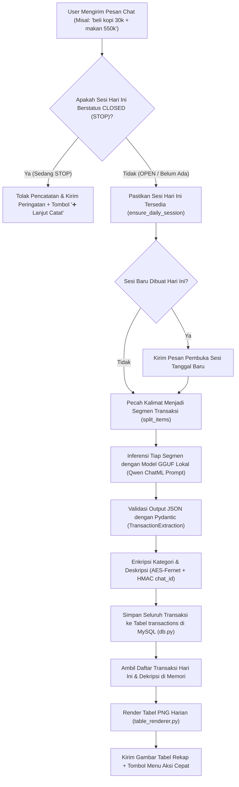

# 💰 HematUang Bot — Asisten Pencatat Keuangan Telegram Berbasis Local LLM (GGUF)

**HematUang Bot** adalah bot Telegram pencatat keuangan harian dan bulanan berbasis **Python (`aiogram` v3)** yang menggunakan **Local LLM GGUF (`llama-cpp-python` / Qwen Fine-Tuned)**, **Enkripsi Database AES-Fernet Per-User**, serta **Visualisasi Tabel Otomatis (`matplotlib`)**.

Pengguna cukup mengirimkan pesan chat biasa — baik satu transaksi (misal: *"Gaji bulanan masuk 5jt"*) maupun **banyak transaksi sekaligus dalam satu chat** (misal: *"beli kopi 30k + makan 550k"* atau dipisah baris baru) — dan bot akan otomatis memecah segmen transaksi, mengekstrak tipe, nominal, kategori, serta keterangannya secara lokal (100% offline/tanpa biaya API cloud), menyimpannya secara terenkripsi ke MySQL/MariaDB, lalu membalas dengan gambar tabel rekap terbaru.

---

## ✨ Fitur Utama

1. **100% Local LLM Inference (`llm_parser.py` — Qwen GGUF)**
   - Menggunakan model GGUF lokal (`model/model.gguf` / `model/hematuang-q4_k_m.gguf`) melalui `llama-cpp-python` dengan multi-threading CPU penuh (`n_threads`, `n_batch=512`).
   - **Multi-Item Splitter (`split_items`)**: Memecah satu pesan yang berisi banyak transaksi (dipisahkan oleh `+`, baris baru `\n`, `;`, koma, atau kata hubung seperti `dan`/`sama`) menjadi beberapa segmen transaksi yang dicatat sekaligus.
   - Validasi output JSON secara ketat menggunakan Pydantic (`TransactionExtraction`).
2. **Enkripsi Data Sensitif Per-User (At-Rest Encryption)**
   - Kolom sensitif (`category` dan `description`) dienkripsi menggunakan **AES-128-CBC + HMAC-SHA256 (`cryptography.fernet`)**.
   - Kunci enkripsi setiap pengguna diturunkan secara unik dari kombinasi `ENCRYPTION_KEY` + `chat_id` menggunakan `HMAC-SHA256`, sehingga data antar-pengguna terisolasi secara kriptografis di database.
3. **Visualisasi Tabel Otomatis (`matplotlib`)**
   - Merender rekap transaksi harian dan bulanan menjadi gambar tabel PNG yang rapi dan tajam langsung di dalam chat Telegram.
   - Dilengkapi ringkasan **Total Masuk**, **Total Keluar**, dan **Selisih Hari Ini / Bulan Ini**.
4. **Menu Tombol Interaktif & Popup Command `/`**
   - Setiap balasan bot dilengkapi tombol aksi cepat (**➕ Lanjut Catat**, **📊 Rekap Hari Ini**, **🗑️ Hapus Transaksi**, **📆 Rekap Bulanan**, **🛑 Stop / Tutup Buku**, **📖 Panduan**).
   - Mendukung penghapusan transaksi spesifik melalui tombol pilihan interaktif (`/hapus`).
   - Proteksi status **STOP**: Saat sesi dihentikan (`/stop`), bot menolak pencatatan baru dan mengingatkan pengguna untuk menekan **➕ Lanjut Catat (Data Tetap Ada)** atau `/start` terlebih dahulu tanpa menghapus data sebelumnya.
5. **Tutup Buku Otomatis Pukul `00:00` WIB (`AsyncIOScheduler`)**
   - Setiap pergantian hari pukul `00:00` WIB (`Asia/Jakarta`), bot otomatis menutup sesi hari sebelumnya (`CLOSED`) dan mengirimkan laporan rekap final beserta kategori pengeluaran terbesar dan akumulasi saldo bulanan secara *silent* (`disable_notification=True`) agar tidak mengganggu waktu istirahat.

---

## 📂 Struktur File Proyek

```text
hematuangBot/
├── bot.py                  # Entry point utama bot, router handler aiogram v3, menu interaktif, & scheduler 00:00 WIB
├── llm_parser.py           # Modul ekstraksi transaksi berbasis Local GGUF (llama-cpp-python + split_items + Pydantic)
├── db.py                   # Modul async database (aiomysql connection pool + enkripsi/dekripsi AES-Fernet per-user)
├── table_renderer.py       # Renderer tabel transaksi harian & bulanan menjadi gambar PNG (matplotlib)
├── schema.sql              # Skema pembuatan database MySQL/MariaDB (tabel daily_sessions & transactions)
├── scripts/
│   └── test_model.py       # Skrip CLI untuk menguji inferensi llm_parser.py secara langsung di terminal
├── model/                  # Folder model GGUF lokal (diabaikan oleh Git melalui .gitignore)
│   └── hematuang-q4_k_m.gguf
├── requirements.txt        # Daftar dependensi Python
├── .env.example            # Template konfigurasi environment variables
├── .env                    # File konfigurasi rahasia (diabaikan oleh Git)
└── .gitignore              # Daftar file/folder yang diabaikan oleh Git (venv, .env, model/, *.gguf, .mplcache)
```

---

## 🔄 Alur Kerja Sistem (Workflow)

### 1. Diagram Alur Pencatatan Transaksi (Single & Multi-Item)



### 2. Alur Penutupan Sesi Otomatis (`00:00` WIB) & Manual (`/stop` / `/tutup`)
1. **Manual (`/stop` atau `/tutup`):**
   - Mengubah status sesi hari ini menjadi `CLOSED` di tabel `daily_sessions`.
   - Menghitung total pemasukan, total pengeluaran, kategori pengeluaran terbesar hari itu, serta akumulasi saldo bulan berjalan.
   - Mengirimkan tabel rekap final dan mengunci sesi hingga pengguna menekan **➕ Lanjut Catat** atau `/start`.
2. **Otomatis (`00:00` WIB via `AsyncIOScheduler`):**
   - Mengecek seluruh sesi tanggal kemarin yang masih berstatus `OPEN`.
   - Jika sesi sudah ditutup manual sebelumnya dengan `/stop` atau `/tutup`, bot tidak akan mengirim ulang laporan.
   - Jika masih `OPEN`, bot mengubah statusnya menjadi `CLOSED` dan mengirimkan tabel rekap final hari kemarin secara *silent*.

---

## 🧩 Penjelasan Detail Setiap Modul

### 1. `llm_parser.py` (Local GGUF Parser & Multi-Item Splitter)
- **`split_items(text)`**: Menggunakan ekspresi reguler (regex) untuk memecah input multi-item yang dipisahkan oleh `+`, baris baru (`\n`), titik koma (`;`), koma, atau kata hubung (`dan`, `sama`, `terus`, `lalu`) menjadi daftar segmen independen tanpa merusak format angka desimal seperti `1,5jt`.
- **Inferensi Qwen ChatML (`parse_segment_sync`)**:
  - Memuat model GGUF satu kali di memori (*singleton*) dengan `n_ctx=1024`, `n_threads=os.cpu_count()`, dan `n_batch=512`.
  - Menggunakan prompt ChatML Qwen:
    ```text
    <|im_start|>system
    Ekstrak transaksi keuangan ke JSON valid.<|im_end|>
    <|im_start|>user
    {segmen}<|im_end|>
    <|im_start|>assistant
    ```
  - Menggunakan `temperature=0.0` dan stop token `["<|im_end|>", "<|endoftext|>"]` agar keluaran JSON selalu deterministik dan tervalidasi ke dalam objek `TransactionExtraction`.

### 2. `db.py` & `schema.sql` (Database & Keamanan Enkripsi)
- **`daily_sessions`**: Menyimpan status sesi harian per pengguna (`session_date`, `chat_id`, `status ENUM('OPEN','CLOSED')`, `created_at`, `closed_at`).
- **`transactions`**: Menyimpan riwayat transaksi (`id`, `session_date`, `chat_id`, `type ENUM('INCOME','EXPENSE')`, `amount`, `category`, `description`, `created_at`).
- **Enkripsi Per-User (`_get_user_fernet`)**:
  - Menggunakan `HMAC-SHA256(ENCRYPTION_KEY, "hematuang_user:<chat_id>")` untuk menghasilkan kunci Fernet 32-byte yang unik bagi setiap `chat_id` dan menyimpannya di cache memori (`_fernet_cache`).
  - Fungsi `insert_transaction()` mengenkripsi `category` dan `description` sebelum masuk ke database, sedangkan `get_transactions_by_date()`, `delete_transaction_by_id()`, dan `get_monthly_summary()` mendekripsinya secara transparan saat dibaca.

### 3. `table_renderer.py` (Visualisasi Tabel PNG)
- Menggunakan `matplotlib` (backend non-GUI `Agg`) dengan direktori cache font lokal (`.mplcache`) agar proses import dan rendering berlangsung cepat.
- Menyediakan dua fungsi utama:
  - `render_daily_table(date_str, transactions)`: Merender tabel transaksi harian beserta baris **TOTAL MASUK**, **TOTAL KELUAR**, dan **SELISIH HARI INI**.
  - `render_monthly_table(year_month, summary)`: Merender tabel rekapitulasi bulanan per tanggal beserta **SALDO / SELISIH BULAN INI**.

### 4. `bot.py` (Controller Utama, Menu Interaktif, & Scheduler)
- Mengatur seluruh command (`/start`, `/lanjut`, `/rekap`, `/bulanan`, `/hapus`, `/restart`, `/stop`, `/tutup`, `/help`) dan callback tombol inline (`menu:*`, `del_tx:*`, `restart_*`).
- Melakukan *pre-loading* model GGUF saat startup sehingga pesan pertama yang dikirim pengguna langsung diproses tanpa jeda pemuatan model.
- Mengimplementasikan `StableAiohttpSession` untuk menjaga kestabilan koneksi ke server Telegram di lingkungan Windows & ISP Indonesia.

---

## 🛠️ Masalah yang Ditemukan & Solusi Rekayasa (Troubleshooting Log)

Selama pengembangan dan pengujian langsung, berbagai kendala teknis berhasil diidentifikasi dan diselesaikan:

| No | Masalah yang Ditemukan | Penyebab Teknis (Root Cause) | Solusi yang Diterapkan |
| :--- | :--- | :--- | :--- |
| **1** | **Ketergantungan & Limitasi Kuota API Eksternal (`404` / `503` / Latency Tinggi)** | Penggunaan API cloud eksternal rentan mengalami antrean server (`503 UNAVAILABLE`), perubahan nama model (`404`), dan latensi jaringan tinggi. | Migrasi penuh ke **Model GGUF Lokal (`llm_parser.py`)** menggunakan `llama-cpp-python` dengan dukungan *multi-item splitting* dan inferensi CPU multi-thread lokal. |
| **2** | **Koneksi Polling Menggantung 30–40 Detik (`[WinError 64]` & `[WinError 121] Semaphore Timeout`)** | Pada Windows + ISP Indonesia, `Dispatcher._listen_updates` bawaan `aiogram` menghitung `request_timeout = session.timeout + polling_timeout` (`31 detik`), dan `AiohttpSession.make_request` menimpa `ClientTimeout` dengan integer sehingga socket yang diputus NAT ISP tetap ditunggu hingga 31–40 detik. | Meng-override `make_request()` pada `StableAiohttpSession` di `bot.py` untuk mengunci jalur ke **IPv4 (`socket.AF_INET`)**, membatasi `sock_connect=2.5s` & `polling_timeout=3s`, serta otomatis me-reset pool socket (`_should_reset_connector = True`) saat koneksi terputus. |
| **3** | **Crash Startup `TelegramNetworkError: Request timeout error` pada `bot.me()`** | Saat `dp.start_polling(bot)` dimulai, `aiogram` memanggil `await bot.me()` (`getMe`) satu kali tanpa mekanisme *retry*. Jika paket pertama di-drop oleh ISP, program langsung berhenti. | Melakukan **Pre-Cache objek `bot._me`** saat inisialisasi `Bot` serta menambahkan *auto-retry* pada `make_request()` sehingga startup tidak pernah gagal. |
| **4** | **Error `TelegramBadRequest: query is too old and response timeout expired`** | Tombol inline ditekan saat bot sedang mati/restart, atau `callback.answer()` dipanggil setelah operasi database selesai sehingga melewati batas waktu 10–30 detik Telegram. | Membuat helper `safe_callback_answer()` yang dipanggil di baris paling awal setiap handler tombol dan menangkap `TelegramBadRequest` dengan aman tanpa menghentikan eksekusi fitur. |
| **5** | **Risiko Transaksi Hilang Saat User Ingin Melanjutkan Sesi** | Tombol *Restart* di menu utama berpotensi ditekan oleh pengguna yang mengira artinya "melanjutkan sesi setelah Stop", padahal mereset transaksi. | Memisahkan alur **➕ Lanjut Catat (Data Tetap Ada)** pada menu kondisi *STOP* dan memindahkan penghapusan transaksi ke menu `/hapus`. |

---

## 🚀 Cara Instalasi & Menjalankan Proyek

### 1. Persiapan Database MySQL / MariaDB
Pastikan layanan MySQL/MariaDB sudah aktif, lalu import skema database:
```powershell
mysql -u root -p < schema.sql
```

### 2. Buat Virtual Environment & Install Dependensi
```powershell
python -m venv venv
.\venv\Scripts\pip install -r requirements.txt
```
*(Untuk instalasi cepat `llama-cpp-python` menggunakan prebuilt wheel CPU:)*
```powershell
.\venv\Scripts\pip install llama-cpp-python --prefer-binary --extra-index-url https://abetlen.github.io/llama-cpp-python/whl/cpu
```

### 3. Siapkan Model GGUF Lokal
Letakkan file model GGUF Anda di dalam folder `model/` (misalnya `model/model.gguf` atau `model/hematuang-q4_k_m.gguf`).

### 4. Konfigurasi File `.env`
Salin `.env.example` menjadi `.env` lalu isi kredensial Anda:
```env
TELEGRAM_BOT_TOKEN=isi_token_bot_telegram_dari_botfather
LOCAL_MODEL_PATH=model/model.gguf

DB_HOST=127.0.0.1
DB_PORT=3306
DB_USER=root
DB_PASSWORD=
DB_NAME=hematuang_db

ENCRYPTION_KEY=isi_kunci_fernet_base64_32_byte
```
*(Untuk membuat `ENCRYPTION_KEY` baru, jalankan: `.\venv\Scripts\python -c "from cryptography.fernet import Fernet; print(Fernet.generate_key().decode())"`)*

### 5. Uji Inferensi Model GGUF di Terminal (Opsional)
Sebelum menjalankan bot, Anda dapat menguji ekstraksi model langsung dari terminal:
```powershell
.\venv\Scripts\python scripts\test_model.py
```

### 6. Jalankan Bot
```powershell
.\venv\Scripts\python bot.py
```

---

## 📱 Daftar Perintah Bot (Slash Commands)

| Command | Fungsi |
| :--- | :--- |
| `/start` | Menampilkan menu utama & mengaktifkan kembali sesi pencatatan |
| `/lanjut` | Melanjutkan pencatatan transaksi pada sesi hari ini (data sebelumnya tetap tersimpan) |
| `/rekap` | Menampilkan gambar tabel rekap transaksi hari ini |
| `/bulanan` | Menampilkan gambar tabel rekap bulanan beserta rincian persentase kategori pengeluaran |
| `/hapus` | Menampilkan daftar tombol transaksi hari ini untuk dipilih mana yang ingin dihapus |
| `/stop` / `/tutup` | Menghentikan sementara sesi hari ini & menampilkan laporan tutup buku harian + akumulasi bulanan |
| `/restart` | Mereset seluruh transaksi hari ini dari nol (dengan dialog konfirmasi keamanan) |
| `/help` | Menampilkan panduan lengkap cara penggunaan bot |
